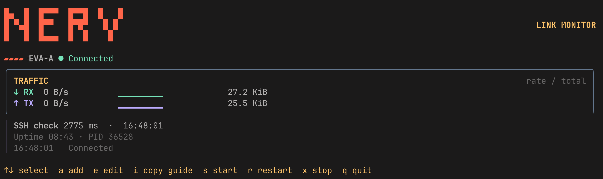
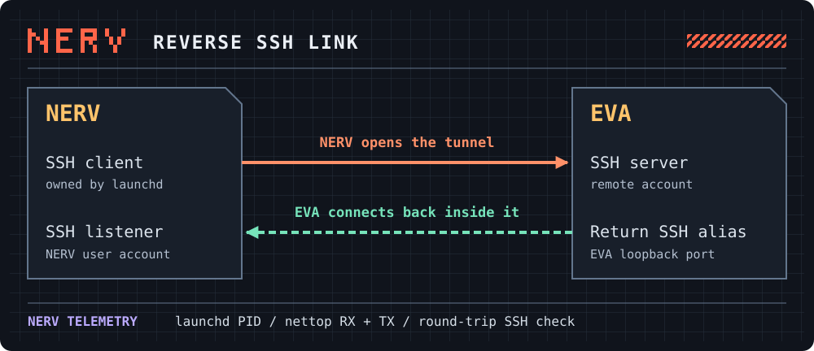

# NERV


<p align="center">
  <a href="https://www.npmjs.com/package/nerv-tunnel"></a>
  <a href="https://github.com/eripley/nerv-tunnel/actions/workflows/build.yml"></a>
  <a href="https://github.com/eripley/nerv-tunnel/actions/workflows/ci.yml"></a>
  <a href="https://github.com/eripley/nerv-tunnel/actions/workflows/ci.yml"></a>
</p>

[Русский](README.ru.md)

NERV helps your coding agent set up a reverse SSH tunnel from your primary machine to each VPS. Its terminal dashboard lets you check which agents can reach your projects, watch traffic, and start, stop or restart each tunnel.

In *Evangelion*, NERV is the command centre that directs the Evangelions. Here, **NERV** is your primary machine and each VPS you connect is an **EVA**.

---

## Install and launch

On your primary machine, use Node.js 22.13 or later and install the CLI globally.

```sh
npm install -g nerv-tunnel
```

**Launch NERV** in a terminal or tmux pane.

```sh
nerv
```

On first launch, the wizard helps you set up a new EVA with your agent or register an existing tunnel. To explore the dashboard with sample data, run `nerv demo`.

When you open the dashboard from a global npm installation, NERV checks the latest npm version. Press Enter to continue with your installed version, or choose **Update** to install the displayed version and reopen the dashboard. An offline registry does not prevent startup. Use `NERV_NO_UPDATE_CHECK=1 nerv` to skip the check, or `nerv --version` to see the installed version.

## When NERV helps

Suppose Claude Code runs on one VPS, Codex on another and Kimi on a third, while the project they need lives on NERV. Give your setup agent the NERV guide to establish a reverse SSH tunnel to each EVA. An agent can then use a familiar SSH alias to read files or run commands on NERV with the permissions of its SSH account. One terminal dashboard shows which routes work, when each was last checked and how much traffic each tunnel carries.



## How the link works

NERV keeps a separate outbound SSH connection to each VPS using a user LaunchAgent. On each EVA, the alias `ssh nerv` points to a loopback port on that VPS. Traffic to that port travels back through its tunnel to the SSH listener on NERV. The monitor checks each active route every 15 seconds with `uname -s`.



## Using NERV with agents

1. **Set up a new tunnel.** Run `nerv agent` on NERV, press **i** in the dashboard, or choose **Set up a new EVA** in the wizard and press **Enter**. The guide opens and NERV copies it to your clipboard. Paste it into the chat of the agent working on NERV. That agent configures the SSH keys, aliases and tunnel service, then checks the round trip. [Tunnel setup guide](docs/agent-setup.md)
2. **Register the tunnel.** Once the agent finishes, press **Esc** to close the guide. In the wizard, press **r** to scan again and choose **Add an existing tunnel**. If you already have a working tunnel, start here with `nerv add`.
3. **Tell the agent on the EVA how to reach NERV.** Press **g** in the dashboard to view and copy the short rule. Paste it into `AGENTS.md` or `CLAUDE.md` on the EVA. The agent works on its EVA by default and uses `ssh nerv` when you explicitly ask it to work on NERV. For example, ask it to list the projects on NERV with `ssh nerv 'ls ~/projects'`. [EVA agent instructions](docs/eva-instructions.md)

In either guide, use **↑/↓** to scroll, **PgUp/PgDn** to move a page, **c** to copy the full Markdown again and **Esc** to close. For scripts, `nerv agent --stdout` prints the setup guide.

## Run from source

```sh
npm ci --ignore-scripts
npm run build
node dist/cli.js demo
```

Use `node dist/cli.js` in place of `nerv` when running from a checkout.

## First connection

1. When registering a tunnel, the wizard looks for a user LaunchAgent in `~/Library/LaunchAgents` that runs `/usr/bin/ssh` with an explicit `-R` forward and ends with the destination SSH alias.
2. Choose a discovered tunnel and give it a display name. Enter the alias the remote machine uses to SSH back to NERV. Use ↑/↓ and Enter to select its dedicated local `sshd` listener, or choose **Skip**. Esc takes you back one step.
3. The wizard checks the round trip using `uname -s`. Review the result and confirm to save. An offline tunnel can also be saved. Each hop must already support unattended key authentication and trust its host key.

Profiles are stored in `${XDG_CONFIG_HOME:-~/.config}/nerv/config.json` with mode `0600`. Addresses and key paths stay in OpenSSH configuration. Use `nerv add` for another EVA. Use `nerv edit PROFILE` to change its display name, tunnel, return SSH alias or listener. Choose **Review changes**, then **Save changes** to apply them.

## Dashboard

| Key | Action |
| --- | --- |
| ↑ / ↓ | Select an EVA |
| a | Add an existing tunnel or set up a new EVA |
| i | View and copy the tunnel setup guide for your agent |
| g | View and copy instructions for `AGENTS.md` or `CLAUDE.md` on the EVA |
| e | Edit the selected profile and review changes before saving |
| s | Enable and start its tunnel and configured listener |
| r | Restart the selected tunnel |
| x | Disable and stop the selected tunnel until started again |
| q | Close the dashboard |

Stop only acts on the tunnel; a companion listener can serve other connections. Closing the panel leaves launchd in control. A tunnel job with `RunAtLoad` and `KeepAlive` can recover when NERV wakes or the network returns.

Traffic counters come from `nettop` for each tunnel PID. Receive/send are from the perspective of NERV and include SSH overhead. The one-second sampler computes rates from counter differences. A dash means a counter is unavailable or a fresh process needs a second sample. Every 15 seconds a separate SSH check runs from NERV to the EVA and back; its duration includes both SSH handshakes. The probe executes only `uname -s` on the return host.

For scripts use `nerv status [PROFILE]`, `nerv start PROFILE`, `nerv stop PROFILE` or `nerv restart PROFILE`. Status exits with code 1 if any selected route is unavailable. Set `NO_COLOR=1` for a monochrome display.

## License

[MIT License](LICENSE) · © 2026 Denis Chen
