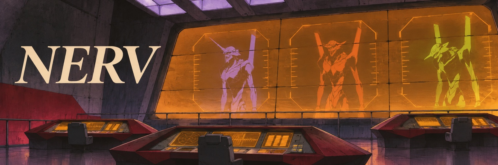
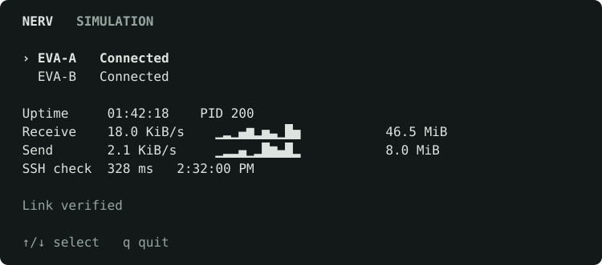

# NERV

[Русский](README.ru.md)



Monitor existing reverse SSH tunnels from your Mac. Each remote machine is an **EVA**. NERV shows whether its SSH process is running, whether the machine can reach your Mac, and how much traffic passes through the tunnel.



## How the link works


The Mac’s user LaunchAgent keeps an outbound SSH connection to the EVA. On the EVA, the return alias points to a loopback port that forwards through this connection to the Mac’s SSH listener. The same layout applies to each EVA. NERV reads process and traffic data on the Mac and periodically tests the full Mac → EVA → Mac route with `uname -s`.

**Setting up a new machine with an agent?** Run `nerv agent` (from a checkout, `node dist/cli.js agent`) and paste the copied setup guide into your agent chat. It covers SSH keys and aliases, the Mac listener, the LaunchAgent, profile registration and verification. Press **i** for the same clipboard action from the live dashboard or tunnel picker. For plain text output use `nerv agent --stdout`. [Read the guide](docs/agent-setup.md)

## Try it

Requires macOS and Node.js 22.13 or later. From this checkout:

```sh
npm ci
npm run build
node dist/cli.js demo
```

Demo mode uses fictional data. To configure a real connection, run `node dist/cli.js` in a terminal. Once you want the global `nerv` command, run `npm link` in the checkout. If another tool already owns that command, use the checkout directly.

## First connection

1. Start with a working reverse tunnel. NERV supports a user LaunchAgent in `~/Library/LaunchAgents` that runs `/usr/bin/ssh` with an explicit `-R` forward and ends with the destination SSH alias.
2. On first launch, choose a discovered tunnel and give it a display name. Enter the alias the remote machine uses to SSH back to the Mac. Use ↑/↓ and Enter to select its dedicated local `sshd` listener, or choose **Skip**. Esc takes you back one step.
3. The wizard checks the round trip using `uname -s`. Review the result and confirm to save. An offline tunnel can also be saved. Each hop must already support unattended key authentication and trust its host key.

Profiles are stored in `${XDG_CONFIG_HOME:-~/.config}/nerv/config.json` with mode `0600`. Addresses and key paths stay in OpenSSH configuration. Use `nerv add` for another EVA. Use `nerv edit PROFILE` to change its display name, tunnel, return SSH alias or listener. Choose **Review changes**, then **Save changes** to apply them.

## Dashboard

| Key | Action |
| --- | --- |
| ↑ / ↓ | Select an EVA |
| a | Add an existing tunnel as a new EVA and select its saved profile |
| i | Copy the environment setup guide for your agent |
| e | Edit the selected profile and review changes before saving |
| s | Enable and start its tunnel and configured listener |
| r | Restart the selected tunnel |
| x | Disable and stop the selected tunnel until started again |
| q | Close the dashboard |

Stop only acts on the tunnel; a companion listener can serve other connections. Closing the panel leaves launchd in control. A tunnel job with `RunAtLoad` and `KeepAlive` can recover when the Mac wakes or the network returns.

Traffic counters come from macOS `nettop` for each tunnel PID. Receive/send are from the Mac’s perspective and include SSH overhead. The one-second sampler computes rates from counter differences. A dash means a counter is unavailable or a fresh process needs a second sample. Every 15 seconds a separate SSH check runs from the Mac to the EVA and back; its duration includes both SSH handshakes. The probe executes only `uname -s` on the return host.

For scripts use `nerv status [PROFILE]`, `nerv start PROFILE`, `nerv stop PROFILE` or `nerv restart PROFILE`. Status exits with code 1 if any selected route is unavailable. Set `NO_COLOR=1` for a monochrome display.

Unofficial Evangelion-inspired project. The cover is original artwork.
