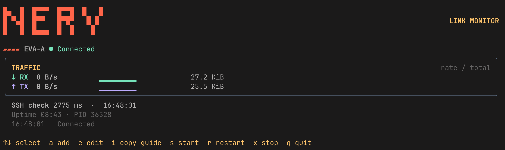
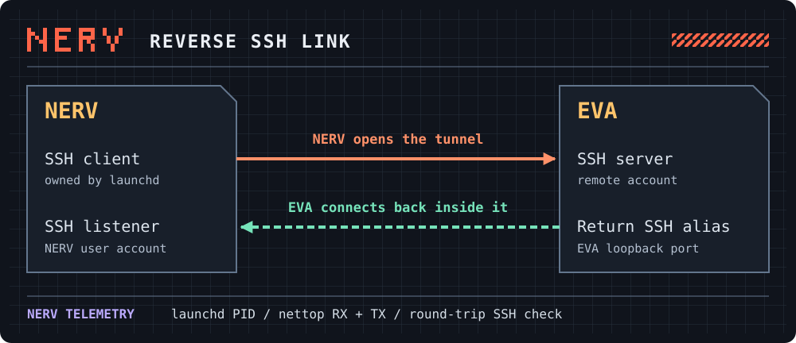

# Установка NERV через npm

```sh
npm install -g nerv-tunnel
```

Понадобится Node.js 22.13 или новее. Запусти `nerv demo`, чтобы посмотреть панель на примере, или `nerv`, чтобы добавить своё соединение.


<p align="center">
  <a href="https://www.npmjs.com/package/nerv-tunnel"></a>
  <a href="https://github.com/eripley/nerv-tunnel/actions/workflows/build.yml"></a>
  <a href="https://github.com/eripley/nerv-tunnel/actions/workflows/ci.yml"></a>
  <a href="https://github.com/eripley/nerv-tunnel/actions/workflows/ci.yml"></a>
</p>

[English](README.md)

В «Евангелионе» NERV — командный центр, из которого координируют действия каждого Евангелиона. Здесь **NERV** — твоя основная машина, а каждый подключённый VPS — отдельная **EVA**.

## Когда пригодится NERV

Допустим, Claude Code работает на одном VPS, Codex — на втором, Kimi — на третьем, а нужный им проект лежит на NERV. Подними с NERV по обратному SSH-туннелю до каждой EVA. Тогда агент сможет по привычному SSH-алиасу читать файлы и выполнять команды на основной машине с правами своей SSH-учётной записи. В одном окне видно, какие маршруты работают, когда их проверяли и сколько трафика прошло по каждому туннелю.



## Как устроено соединение

Для каждого VPS пользовательский LaunchAgent на NERV держит отдельное исходящее SSH-соединение. На каждой EVA команда `ssh nerv` подключается к локальному порту этой VPS. Через него запрос возвращается по туннелю к SSH-серверу на NERV. Раз в 15 секунд монитор проверяет каждый активный маршрут командой `uname -s`.



## Как работать с агентами

1. **Подготовь соединение.** На NERV выполни `nerv agent` (из каталога проекта — `node dist/cli.js agent`) или нажми **i** в панели. Вставь скопированную инструкцию в чат агента, который займётся настройкой. В ней описаны ключи, алиасы, служба туннеля и проверка маршрута. Для удобства можно выбрать один обратный алиас, например `nerv`, на всех EVA. [Инструкция для агента](docs/agent-setup.md)
2. **Зарегистрируй EVA.** Нажми **a** и выбери **Add an existing tunnel**, чтобы добавить туннель в панель. Пункт **Set up a new EVA** открывает инструкцию для агента. Если свободных туннелей нет, мастер сразу предложит скопировать инструкцию. Когда агент закончит настройку, выбери **Scan again for new tunnels**. Повтори для остальных VPS. Чтобы прочитать инструкцию в терминале, выполни `nerv agent --stdout`.
3. **Дай агенту задачу.** Например, попроси агента на EVA показать список проектов на NERV командой `ssh nerv 'ls ~/projects'`. Команды через этот алиас выполняются на NERV. Остальные команды в оболочке агента выполняются на его EVA.

## Запуск из исходников

```sh
npm ci --ignore-scripts
npm run build
node dist/cli.js demo
```

При работе из каталога проекта используй `node dist/cli.js` вместо `nerv`.

## Первое подключение

1. Подготовь работающий обратный туннель. Поддерживается пользовательский LaunchAgent из `~/Library/LaunchAgents`, который запускает `/usr/bin/ssh` с явным пробросом `-R` и SSH-алиасом назначения в конце.
2. При первом запуске выбери найденный туннель, дай ему имя и введи SSH-алиас, по которому удалённая машина подключается обратно к NERV. Стрелками ↑/↓ выбери локальный SSH-сервер для этого туннеля или пункт **Skip** и нажми Enter. Клавиша Esc возвращает на предыдущий шаг.
3. Мастер выполнит `uname -s` по полному маршруту и предложит сохранить профиль. Профиль можно сохранить и при выключенном туннеле. Для обоих направлений заранее настрой вход по ключу и проверку ключа хоста.

Настройки хранятся в `${XDG_CONFIG_HOME:-~/.config}/nerv/config.json` с правами `0600`. Адреса и пути к ключам остаются в конфигурации OpenSSH. Чтобы добавить ещё одну EVA, выполни `nerv add`. Команда `nerv edit ПРОФИЛЬ` позволяет изменить имя, туннель, обратный SSH-алиас или локальный SSH-сервер. Выбери **Review changes**, затем **Save changes** для сохранения.

## Панель

| Клавиша | Действие |
| --- | --- |
| ↑ / ↓ | Выбрать EVA |
| a | Добавить существующий туннель или настроить новую EVA |
| i | Скопировать инструкцию по настройке окружения для агента |
| e | Открыть настройки выбранного профиля и проверить изменения перед сохранением |
| s | Включить туннель и указанный в профиле локальный SSH-сервер |
| r | Перезапустить выбранный туннель |
| x | Остановить туннель до следующей команды запуска |
| q | Закрыть панель |

Остановка затрагивает только выбранный туннель. Отдельный локальный SSH-сервер может обслуживать и другие подключения. После выхода из панели службами управляет launchd. Если для туннеля настроены `RunAtLoad` и `KeepAlive`, соединение восстанавливается после сна NERV или возвращения сети.

Раз в секунду NERV получает счётчики процесса через `nettop`. Приём и отправка показаны со стороны NERV, включая служебный трафик SSH. Прочерк означает, что счётчик недоступен или для расчёта скорости нужна вторая выборка. Раз в 15 секунд утилита отдельно проверяет маршрут NERV → EVA → NERV. Время проверки включает два SSH-подключения и выполнение `uname -s`.

Для скриптов есть `nerv status [ПРОФИЛЬ]`, `nerv start ПРОФИЛЬ`, `nerv stop ПРОФИЛЬ` и `nerv restart ПРОФИЛЬ`. Если хотя бы один выбранный маршрут недоступен, `status` возвращает код 1. Для монохромного интерфейса задай `NO_COLOR=1`.
